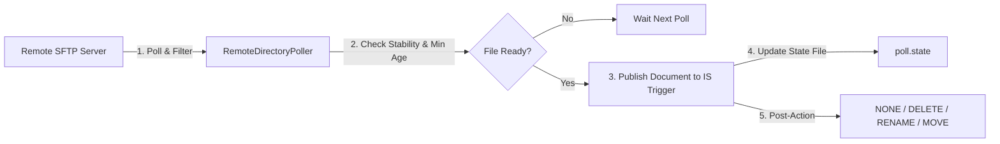

# IBM webMethods Adapter for SSH (WxSshAdapter)

A modern, high-performance **IBM webMethods Integration Server Adapter** built on the webMethods **Adapter Development Kit (ADK)** and powered by [SSHJ](https://github.com/hierynomus/sshj). 

`WxSshAdapter` provides comprehensive SSH capabilities directly within webMethods Integration Server and Service Designer: remote command execution, full SFTP browsing and management, SCP file/directory transfers, interactive shell automation, SSH subsystems, first-time host-key trust utilities, and an event-driven **Remote Directory Polling Notification**.

---

## Table of Contents
- [Features & Capabilities](#features--capabilities)
- [System Requirements](#system-requirements)
- [Installation & Deployment](#installation--deployment)
  - [Deploying the Pre-Built Package](#deploying-the-pre-built-package)
  - [Building from Source](#building-from-source)
- [Connection Configuration](#connection-configuration)
  - [Connection Properties Reference](#connection-properties-reference)
  - [Host-Key Verification & Trust Management](#host-key-verification--trust-management)
- [Adapter Services Guide & Examples](#adapter-services-guide--examples)
  - [1. Remote Command Execution (`ExecCommand`)](#1-remote-command-execution-execcommand)
  - [2. SFTP Browse Services](#2-sftp-browse-services)
  - [3. SFTP File Transfers](#3-sftp-file-transfers)
  - [4. SFTP File & Directory Management](#4-sftp-file--directory-management)
  - [5. SCP File & Directory Transfers](#5-scp-file--directory-transfers)
  - [6. Interactive Shell & Subsystem Services](#6-interactive-shell--subsystem-services)
  - [7. Host-Key Admin Services](#7-host-key-admin-services)
- [Remote Directory Polling Notification](#remote-directory-polling-notification)
  - [Notification Settings Reference](#notification-settings-reference)
  - [Published Document Schema](#published-document-schema)
  - [Step-by-Step Notification & Trigger Setup](#step-by-step-notification--trigger-setup)
- [Architecture & Design Highlights](#architecture--design-highlights)
- [License & Disclaimer](#license--disclaimer)

---

## Features & Capabilities

* **Connection Pooling & Channel Limiter**: Managed connection pooling with automatic reconnection on server drops and a built-in channel semaphore to safely respect server channel caps (e.g. OpenSSH `MaxSessions`).
* **Strict Host-Key Security**: Supports `KNOWN_HOSTS`, `PINNED_FINGERPRINT` (SHA-256), and `ACCEPT_ANY` (dev only) policies, plus first-time host-key discovery services.
* **Authentication Options**: Password, Public Key (OpenSSH / PEM file or inline PEM string with optional passphrase), and Keyboard-Interactive.
* **Remote Command Execution (`ExecCommand`)**: Run shell commands with configurable timeouts, optional PTY allocation, and complete capture of stdout, stderr, exit code, and termination signal.
* **Full SFTP Suite (21 Services)**:
  * **Browse**: List directories with glob filtering, recursive directory walking, hidden file toggles, and metadata inspection (`stat`, `exists`, `realPath`, `readLink`).
  * **Transfers**: In-memory and file-based streaming transfers with optional atomic `.part` upload staging to prevent partial reads by downstream systems.
  * **Management**: Create directories (`mkdir` with parent auto-creation), recursive directory removal (`rmdir`), file renaming with parent creation & overwrite controls, symlinks, recursive permission changes (`chmod` octal modes), recursive ownership changes (`chown` by user/group name or uid/gid), file resizing (`truncate`), and timestamp updates (`setTimes`).
* **SCP Support (`ScpUpload`, `ScpDownload`)**: Seamless SCP support for transferring files, raw bytes, and recursive directory trees to/from servers without SFTP.
* **Interactive Shell & Subsystems**: Multi-step interactive login shell scripts (`RunShellScript`) driven line-by-line with prompt regular expressions, and single-turn SSH subsystems (`StartSubsystem` for NETCONF, `sftp`, or custom subsystems).
* **Remote Directory Polling Notification**: Built-in polling notification that watches remote SFTP directories, enforces stability checks for in-flight uploads, tracks seen files across server restarts via persistent state files, and executes post-delivery actions (`NONE`, `DELETE`, `RENAME`, `MOVE`).

---

## System Requirements

* **Platform**: IBM webMethods Integration Server / Microservices Runtime / webMethods Service Designer (versions 10.x, 11.x, or 12.x).
* **Runtime Java**: Java 17 or Java 21 (IBM Semeru JDK or Oracle/OpenJDK).
* **Build Tools (optional)**: Maven 3.9+ and JDK 21 (if building from source).

---

## Installation & Deployment

### Deploying the Pre-Built Package

1. Download the release package `WxSshAdapter.zip`.
2. Copy `WxSshAdapter.zip` to your Integration Server inbound directory:
   ```text
   <IntegrationServer_Home>/replicate/inbound/WxSshAdapter.zip
   ```
3. Open your browser and log into **Integration Server Administrator** (`http://localhost:5555`).
4. Navigate to **Packages** &rarr; **Management** &rarr; **Install Inbound Releases**.
5. Select `WxSshAdapter.zip` from the dropdown list and click **Install Release**.
6. The package will unpack into `packages/WxSshAdapter/` and register with WmART. Verify by navigating to **Adapters** &rarr; **IBM webMethods Adapter for SSH**.

*(Alternative Manual Installation)*: Unzip `WxSshAdapter.zip` directly into `<IntegrationServer_Home>/packages/WxSshAdapter/` and reload the package in IS Administrator.

---

### Building from Source

To compile and package `WxSshAdapter` from source:

1. Clone this repository:
   ```bash
   git clone https://github.com/luisloja/wx-ssh-adapter.git
   cd wx-ssh-adapter
   ```
2. Build the core library and execute the test suite:
   ```powershell
   # Point JAVA_HOME to a JDK 21
   $env:JAVA_HOME = 'C:\wMServiceDesigner\jvm\jvm'
   mvn clean verify
   ```
3. Run the automated packaging script:
   ```powershell
   .\build-package.ps1
   ```
   This script gathers runtime dependencies (`sshj-0.40.0.jar`, `asn-one-0.6.0.jar`, Bouncy Castle), compiles ADK classes, builds `WxSshAdapter.zip`, and automatically deploys it to your local Service Designer environment.

---

## Connection Configuration

In **Software AG Designer** or **IS Administrator**:
1. In Designer, right-click your package folder &rarr; **New** &rarr; **Adapter Connection**.
2. Select **IBM webMethods Adapter for SSH** &rarr; **SSH Connection**.
3. Fill in the connection properties and save.

### Connection Properties Reference

| Property Group | Field Name | Description | Default / Example |
| :--- | :--- | :--- | :--- |
| **Server** | Host Name / IP (`host`) | Remote SSH server hostname or IP address | `192.168.1.100` |
| | Port Number (`port`) | Remote SSH server port | `22` |
| | Connect Timeout (`connectTimeoutMs`) | Socket connect timeout in milliseconds | `30000` |
| | Read Timeout (`readTimeoutMs`) | Channel read timeout in milliseconds | `30000` |
| | Keep-Alive Interval (`keepAliveSeconds`)| Heartbeat interval in seconds (`0` = disabled) | `0` |
| | Max Concurrent Channels (`maxConcurrentChannels`)| Max concurrent channels per connection. Keep at or below server's `MaxSessions` (OpenSSH default 10). | `8` |
| | Compression Enabled (`compression`) | Enable zlib transport compression (`true`/`false`) | `false` |
| **Authentication** | Authentication Method (`authMethod`) | `PASSWORD`, `PUBLIC_KEY`, or `KEYBOARD_INTERACTIVE` | `PASSWORD` |
| | User Name (`username`) | SSH login user account name | `sftpuser` |
| | Password (`password`) | SSH password (for password / keyboard-interactive) | `********` |
| | Private Key File Path (`privateKeyPath`) | Filesystem path to OpenSSH / PEM private key | `C:/keys/id_ed25519` |
| | Private Key PEM (`privateKeyPem`) | Inline PEM-formatted private key string | `-----BEGIN OPENSSH...` |
| | Private Key Passphrase (`keyPassphrase`) | Passphrase if private key is encrypted | `********` |
| **Trust & Host Key**| Host Key Policy (`hostKeyPolicy`) | `ACCEPT_ANY` (dev only), `KNOWN_HOSTS`, or `PINNED_FINGERPRINT` | `KNOWN_HOSTS` |
| | Known Hosts File Path (`knownHostsPath`) | Path to OpenSSH-formatted `known_hosts` file | `packages/WxSshAdapter/config/known_hosts` |
| | Pinned SHA-256 Fingerprint (`pinnedFingerprint`)| Pinned fingerprint (e.g. `SHA256:abc...`) | `SHA256:...` |

---

### Host-Key Verification & Trust Management

For production security, avoid `ACCEPT_ANY`. To configure trusted connections easily:

1. **Discover Fingerprint**:
   Run the administrative service `wm.adapter.wxssh.admin:getHostKeyFingerprint` in Designer with your remote `host` and `port`. It returns the key algorithm and SHA-256 fingerprint without authenticating.
2. **Add to Known Hosts**:
   Run `wm.adapter.wxssh.admin:addToKnownHosts` with:
   * `host`: remote host
   * `port`: remote port (e.g. `22`)
   * `knownHostsPath`: path to your `known_hosts` file (e.g. `packages/WxSshAdapter/config/known_hosts`)
   * `expectedFingerprint`: the fingerprint from step 1
3. Set your connection's **Host Key Policy** to `KNOWN_HOSTS` and specify the `knownHostsPath`.

---

## Adapter Services Guide & Examples

All services are created in Designer via: **New** &rarr; **Adapter Service** &rarr; Select your SSH Connection &rarr; Choose the service template.

---

### 1. Remote Command Execution (`ExecCommand`)
Executes an arbitrary command on the remote host over SSH.

* **Template Settings**:
  * `defaultCommand`: Default command to execute if not passed dynamically in pipeline.
  * `timeoutSeconds`: Command timeout in seconds (default: `30`).
  * `allocatePty`: Request pseudo-terminal (`true`/`false`).
* **Runtime Inputs**: `command` (overrides default), `workingDirectory` (e.g. `/var/log`).
* **Runtime Outputs**: `stdout` (String), `stderr` (String), `exitStatus` (Integer), `timedOut` (Boolean), `exitSignal` (String).

---

### 2. SFTP Browse Services

* **`SftpList`**: Lists directory entries.
  * *Inputs*: `remotePath` (default `.`), `filter` (glob pattern, e.g. `*.csv`, `order_*.{xml,json}`), `recursive` (`true`/`false`), `includeHidden` (`true`/`false`).
  * *Outputs*: `entries` Document List (`name`, `path`, `size`, `mtime`, `type` [`FILE`, `DIRECTORY`, `SYMLINK`], `permissions`, `atime`, `uid`, `gid`), `count`.
* **`SftpStat`**: Inspects attributes of a remote file or folder.
  * *Inputs*: `remotePath`, `followLinks` (`true` resolves link target; `false` stats link itself).
  * *Outputs*: `exists` (Boolean), `entry` Document (`size`, `mtime`, `type`, `permissions`, `uid`, `gid`).
* **`SftpExists`**: Fast existence and type check.
  * *Inputs*: `remotePath`, `followLinks`.
  * *Outputs*: `exists` (Boolean), `type` (String: `FILE`, `DIRECTORY`, `SYMLINK`, `UNKNOWN`).
* **`SftpRealPath`**: Resolves canonical absolute remote path (e.g. resolves `.` or relative symlinks).
  * *Inputs*: `remotePath`.
  * *Outputs*: `canonicalPath`.
* **`SftpReadLink`**: Reads the target destination of a symbolic link.
  * *Inputs*: `remotePath`.
  * *Outputs*: `isLink` (Boolean), `target` (String).

---

### 3. SFTP File Transfers

* **`SftpGet`**: Downloads a file from remote SFTP host.
  * *Inputs*: `remotePath`, `localFilePath` (optional: destination on IS filesystem; if omitted, content is returned in pipeline), `charset` (default `UTF-8`).
  * *Outputs*: `content` (String), `bytes` (byte[]), `size` (Long).
* **`SftpPut`**: Uploads a file to remote SFTP host.
  * *Inputs*: `remotePath`, `localFilePath` (path on IS) OR `content` (String) OR `bytes` (byte[]), `atomic` (`true` uploads to `.part` file first then renames atomically; `false` writes directly).
  * *Outputs*: `bytesWritten` (Long).

---

### 4. SFTP File & Directory Management

* **`SftpMkdir`**: Creates remote directory. Supports `parents=true` to recursively create parent folders.
* **`SftpDelete`**: Deletes a single remote file or symbolic link.
* **`SftpRmdir`**: Removes a directory. Supports `recursive=true` to delete directory trees.
* **`SftpRename`**: Renames or moves a file/directory. Supports `overwrite=true` and `createParents=true`.
* **`SftpSymlink`**: Creates a symbolic link (`linkPath` &rarr; `target`).
* **`SftpChmod`**: Changes permissions using octal notation (e.g. `0755`, `0644`). Supports `recursive=true` and separate `directoryPermissions`.
* **`SftpChown`**: Changes user/group ownership by user/group name (e.g. `appuser`) or numeric `uid`/`gid`. Supports `recursive=true`.
* **`SftpSetTimes`**: Updates `modifiedSec` and/or `accessedSec` timestamps (seconds since epoch).
* **`SftpTruncate`**: Resizes a remote file to a specified byte length (e.g. `0` to empty file).

---

### 5. SCP File & Directory Transfers

For remote servers offering SCP without SFTP subsystem support:

* **`ScpUpload`**: Uploads local file, memory bytes/content, or a whole directory tree (`recursive=true`).
* **`ScpDownload`**: Downloads remote file (into memory or local file) or recursive remote directory tree (`recursive=true`).

---

### 6. Interactive Shell & Subsystem Services

* **`RunShellScript`**: Drives an interactive remote login shell step-by-step.
  * *Settings/Inputs*: `script` (script lines, one per command), `promptPattern` (regex matching prompt, e.g. `[$#>] $`), `timeoutSeconds` (timeout per step), `allocatePty` (default `true`).
  * *Outputs*: `output` (full text), `steps` Document List (`command`, `output`, `timedOut`), `closedByServer`.
* **`StartSubsystem`**: Connects to a named SSH subsystem (e.g. `netconf`, `sftp`).
  * *Settings/Inputs*: `subsystem` (name), `input` (text payload) or `inputBytes`, `expect` (regex pattern marking end of response), `timeoutSeconds`.
  * *Outputs*: `output` (String), `outputBytes` (byte[]), `timedOut`.

---

### 7. Host-Key Admin Services

* **`wm.adapter.wxssh.admin:getHostKeyFingerprint`**: Discovers the remote host's public key fingerprint without authenticating.
* **`wm.adapter.wxssh.admin:addToKnownHosts`**: Writes host key entry to a `known_hosts` file safely and idempotently.

---

## Remote Directory Polling Notification

The **`RemoteDirectoryPoll`** notification continuously monitors a remote directory on an SSH/SFTP server and automatically publishes an Integration Server document when new or updated files arrive.



### Notification Settings Reference

| Setting | Type | Default | Description |
| :--- | :--- | :--- | :--- |
| **Directory** (`directory`) | String | *(Required)* | Remote directory to monitor (e.g. `/inbox`). |
| **File Name Filter** (`filter`) | String | `*` | Glob pattern matching filenames (e.g. `*.csv`, `order_*.xml`). |
| **Recursive** (`recursive`) | Boolean | `false` | Also monitor sub-directories. |
| **Minimum Age** (`minAgeSeconds`) | Integer | `0` | Minimum file age in seconds before picking up. |
| **Stability Check** (`stabilityCheck`)| Boolean | `true` | Requires file size & mtime to remain identical across two consecutive polls (prevents grabbing in-flight uploads). |
| **After Delivery** (`postAction`)| Enum | `NONE` | Action after successful publish: `NONE`, `DELETE`, `RENAME`, or `MOVE`. |
| **Action Argument** (`postActionArg`)| String | | Suffix for `RENAME` (e.g. `.done`) or directory path for `MOVE` (e.g. `/archive`). |
| **Sort Order** (`sortOrder`) | Enum | `NAME` | Delivery order: `NAME`, `OLDEST_FIRST`, `NEWEST_FIRST`. |
| **Max Files Per Poll** (`maxFilesPerPoll`)| Integer | `100` | Maximum files delivered per poll cycle. |
| **Include Content** (`includeContent`)| Boolean | `false` | Include file payload directly in notification document. |
| **Max Content Bytes** (`maxContentBytes`)| Integer | `1048576` | Maximum file size in bytes to include in-memory (1 MiB default). |
| **Character Set** (`charset`) | String | `UTF-8` | Character encoding for decoding text content. |
| **State File** (`stateFilePath`) | String | *(Auto)* | Path to state persistence file. Default: `<IS>/packages/WxSshAdapter/config/poll-state/<NotificationName>.state`. |

---

### Published Document Schema

When a file is picked up, the notification automatically publishes a document (`<NotificationName>PublishDocument`) containing:

| Field | Type | Description |
| :--- | :--- | :--- |
| `path` | `String` | Full remote path of the polled file (e.g. `/inbox/orders_001.csv`). |
| `name` | `String` | Base filename (e.g. `orders_001.csv`). |
| `directory` | `String` | Watched directory path. |
| `size` | `String` | File size in bytes. |
| `modifiedSec` | `String` | File modification time (seconds since epoch). |
| `contentSkipped` | `String` | `true` if content was requested but file exceeded `maxContentBytes`. |
| `content` | `String` | Decoded text content (if `includeContent=true` and under size limit). |
| `contentBytes` | `Object` (`byte[]`) | Raw binary content (if `includeContent=true` and under size limit). |

---

### Step-by-Step Notification & Trigger Setup

1. **Create the Notification**:
   In Designer, right-click package folder &rarr; **New** &rarr; **Adapter Notification** &rarr; Select **IBM webMethods Adapter for SSH** &rarr; **RemoteDirectoryPoll**.
2. **Configure Settings**:
   Enter your watched directory, filter, and post-action (e.g. `postAction=RENAME`, `postActionArg=.done`). Save the notification. Designer will automatically generate the corresponding `<NotificationName>PublishDocument`.
3. **Create a Processing Flow Service**:
   Create a flow service that accepts `<NotificationName>PublishDocument` as input and implements your business logic (e.g., parsing the CSV or routing the file).
4. **Create a Trigger**:
   Create an **Adapter Notification Trigger** subscribing to `<NotificationName>PublishDocument` and pointing to your processing flow service.
5. **Enable the Notification Schedule in IS Admin**:
   * Open **IS Administrator** (`http://localhost:5555`) &rarr; **Adapters** &rarr; **webMethods Adapter for SSH** &rarr; **Polling Notifications**.
   * Click the **Pencil icon** (`Edit Schedule`) next to your notification.
   * Enter the **Interval (seconds)** (e.g. `10` or `30`) and click **Save Changes**.
   * Change the **State** dropdown to **Enabled**.

---

## Architecture & Design Highlights

```text
┌────────────────────────────────────────────────────────────────────────┐
│                      webMethods Integration Server                     │
│                                                                        │
│   ┌────────────────────────────────────────────────────────────────┐   │
│   │               ADK Layer (com.wm.adapter.wxssh.*)               │   │
│   │   - WxSshAdapter & SshConnectionFactory (WmManagedConnection)   │   │
│   │   - 21 Adapter Service Templates (WmAdapterService)            │   │
│   │   - RemoteDirectoryPollNotification (WmPollingNotification)    │   │
│   └───────────────────────────────┬────────────────────────────────┘   │
│                                   │ invokes                            │
│   ┌───────────────────────────────▼────────────────────────────────┐   │
│   │              SSHJ Façade (com.luisloja.wxssh.core)             │   │
│   │   - SshSession (Channel Limiter Semaphore & Retry Logic)       │   │
│   │   - RemoteDirectoryPoller & Persistent State Tracker           │   │
│   │   - ExpectStream & Shell/Subsystem Driver                      │   │
│   │   - SshAdapterException & Standard ErrorCode Hierarchy         │   │
│   └───────────────────────────────┬────────────────────────────────┘   │
└───────────────────────────────────┼────────────────────────────────────┘
                                    │ SSH-2 / SFTP / SCP
                                    ▼
                         ┌────────────────────┐
                         │ Remote SSH Server  │
                         └────────────────────┘
```

* **Decoupled ADK & Core Architecture**: All SSH, SFTP, SCP, and Polling algorithms live in `com.luisloja.wxssh.core` completely free of webMethods ADK classes. This enables full unit and integration testing without requiring a running Integration Server.
* **Channel Limiter & Fair Semaphore**: `SshSession` shares a single transport while providing isolated channels per operation. A fair concurrency semaphore (`maxConcurrentChannels`, default 8) keeps channel usage safely below server limits (e.g. OpenSSH `MaxSessions 10`).
* **Connection Resilience & Auto-Healing**: Pooled connections automatically detect dead underlying transports (e.g. after remote server restarts) and transparently reconnect on the next request.
* **Safe In-Memory Bounds**: All memory payloads are bounded by configurable byte caps (`maxInMemoryBytes`) to safeguard Integration Server JVM memory.

---

## License & Disclaimer

This project is open-source under the [Apache License 2.0](LICENSE).

*Disclaimer*: This adapter is a community-driven project built on the Software AG / IBM webMethods Adapter Development Kit (ADK) and SSHJ. It is not an official product of IBM or Software AG. All brand names and trademarks belong to their respective owners.
